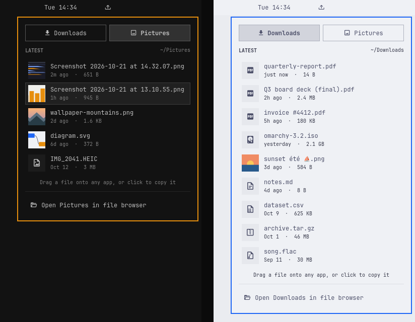

# Slingshot

Your newest downloads and screenshots, one click away, for the
[Omarchy](https://omarchy.org) bar.

Slingshot puts a tray icon in the bar. Click it and a dropdown lists the
latest files in your Downloads or Pictures folder, with thumbnails for
images. Drag any file straight out onto another app:

- **a terminal** (foot, Ghostty, Alacritty, Kitty) gets the file's path typed
  at the cursor, which is how you hand a screenshot to Claude Code or any other
  CLI;
- **a browser or chat app** attaches the file;
- **a file manager** copies it.

Or don't drag at all: click a file (or press its number, 1 to 0) and it's
pasted into the window you were in before you opened the menu. A terminal
gets the path, everything else gets the file itself. Right-click copies it to
the clipboard instead.

Or skip the menu: with the [paste keys](#paste-keys) set up, Super+Alt+D
pastes your newest download into the window you're in, and Super+Alt+Shift+D
then 3 pastes the third-newest.

Working over SSH? The optional `slingshot-ssh` wrapper makes a drop onto a
terminal that's logged into another machine upload the file there and type the
remote path instead (see [SSH drop proxy](#ssh-drop-proxy)).



## What it does

- **Bar icon.** A tray glyph that toggles the dropdown. A small accent dot
  shows when a new file landed in the last minute and you haven't looked yet.
- **Downloads | Pictures.** A two-way switch at the top. Until you pick one,
  each open shows whichever folder holds the newest file (Pictures if your
  latest screenshot is newer than your latest download, Downloads otherwise).
  Once you pick a folder by hand, Slingshot stays on it until the shell
  restarts.
- **The list.** The newest 12 regular files (configurable, 5 to 30) by
  modification time, not recursive. Hidden files, folders and downloads still
  in progress (`.part`, `.crdownload`, `.download`, `.tmp`, plus the empty
  placeholder Firefox writes beside a `.part` file) never show. Each row has a
  thumbnail or a file-type glyph, the name (shortened in the middle when long),
  how long ago it changed, and its size.
- **Live.** The list updates by itself as files arrive or get renamed. It uses
  inotify through Qt's folder model, so nothing polls, open or closed.
- **Folders from XDG.** Paths come from `xdg-user-dir DOWNLOAD` and
  `xdg-user-dir PICTURES` (your `~/.config/user-dirs.dirs`), never hard-coded.
  A folder that is missing or unreadable says so instead of looking empty.
- **Footer.** "Open Downloads in file browser" (or Pictures) runs `xdg-open`
  on the folder and closes the dropdown.

### Mouse and keyboard

| In the dropdown | Does |
|---|---|
| Drag a row | Drag the file onto another app |
| Click a row | Paste the file into the window that was focused before the menu opened |
| `1` … `9`, `0` | Paste the 1st … 10th file (each row shows its number) |
| Right-click a row, or `c` | Copy the file to the clipboard (`text/uri-list`) |
| Middle-click a row | Open the file with its default app |
| `j` / `k` or arrows | Move the cursor |
| `Enter` / `Space` | Paste the file under the cursor into that previous window |
| `o` | Open the file under the cursor |
| `h` / `l`, `d` / `p` | Switch to Downloads / Pictures |
| `f` | Open the folder in your file browser |
| `Tab` | Move to the next bar panel (Omarchy's usual) |
| `Esc` | Close |

A paste puts the right thing on the clipboard for the window it lands in. A
terminal (Omarchy's `terminal` window tag, or a known terminal class) gets the
shell-quoted path as plain text and Ctrl+Shift+V. Anything else gets the file
as `text/uri-list` and Ctrl+V, which browsers, Electron chat apps and file
managers paste as the file. If the window you came from has closed or is on a
workspace you've left, nothing is pasted: the file is copied and a
notification says so.

Right-click copies the file as `text/uri-list`, so Ctrl+V in a file manager or
browser pastes the file itself.

## Install

From the Omarchy plugin catalog, or straight from git:

```bash
omarchy plugin add https://github.com/supercleanse/slingshot
omarchy plugin enable supercleanse.slingshot
```

Plugins land disabled so you can read the code first. Bar widgets start in
the right section; move it with `omarchy bar move` or by dragging it in the
bar.

From a local checkout, `./install.sh` copies the plugin into
`~/.config/omarchy/plugins/supercleanse.slingshot/` (and links
`bin/slingshot-ssh` into `~/.local/bin/` when it is there). Then run
`omarchy plugin enable supercleanse.slingshot`.

Slingshot needs `wl-clipboard` (for click-to-copy), `xdg-user-dirs` and
`xdg-utils`, all present on a stock Omarchy install.

## Remove

```bash
omarchy plugin remove supercleanse.slingshot
```

That deletes the plugin folder and takes the widget out of the bar. Slingshot
writes no files of its own. Remove the `~/.local/bin/slingshot` link, and the paste
keys from `~/.config/hypr/bindings.lua` if you added them. If you set up the SSH drop proxy, also delete the
`ssh()` function from `~/.bashrc`, remove the `~/.local/bin/slingshot-ssh`
link, and (if you created one) `~/.config/slingshot/`. Files already uploaded
to remote hosts stay in `~/Downloads/Slingshot` there.

### Paste keys

`install.sh` links a `slingshot` command into `~/.local/bin`:

```bash
slingshot paste downloads 3    # paste the 3rd-newest download into the focused window
slingshot paste pictures       # the newest picture
slingshot list downloads       # the ten newest paths, in dropdown order
```

It pastes into the window that has focus when it runs, so it suits a
keybinding. With these in `~/.config/hypr/bindings.lua`:

- Super+Alt+D (or P) pastes the newest download (or picture) straight away.
- Super+Alt+Shift+D (or P) waits for one more key: `1` to `9` or `0` pastes
  that file, and anything else cancels. You can keep the modifiers held for
  the digit.

```lua
local function slingshot_keys(folder, label, key)
  local submap = "slingshot-" .. folder
  local function paste(n)
    return hl.dsp.exec_cmd("slingshot paste " .. folder .. " " .. n)
  end
  hl.define_submap(submap, "reset", function()
    for n = 1, 10 do
      local digit = tostring(n % 10)
      hl.bind(digit, paste(n))
      hl.bind("SUPER + ALT + SHIFT + " .. digit, paste(n))
    end
    hl.bind("Escape", hl.dsp.submap("reset"))
    hl.bind("catchall", hl.dsp.submap("reset"))
  end)
  o.bind("SUPER + ALT + " .. key, "Slingshot: paste newest from " .. label, paste(1))
  o.bind("SUPER + ALT + SHIFT + " .. key, "Slingshot: paste from " .. label .. " by number", function()
    hl.dispatch(hl.dsp.submap(submap))
    hl.dispatch(hl.dsp.exec_cmd("notify-send -a Slingshot -u low -t 2500 -h string:x-canonical-private-synchronous:slingshot '" ..
      label .. "' 'Press 1-9 or 0 to paste that file, Esc to cancel'"))
  end)
end
slingshot_keys("downloads", "Downloads", "D")
slingshot_keys("pictures", "Pictures", "P")
```

On a stock Omarchy all four combos are unbound. While the number mode waits,
Super+Alt+Shift+1 to 0 mean "paste", not Omarchy's "move window silently to
workspace".

### Opening the dropdown from a key

The widget answers the usual panel IPC:

```bash
omarchy-shell supercleanse.slingshot toggle   # also open, close
```

So, for example:

```lua
o.bind("SUPER + ALT + O", "Slingshot", "omarchy-shell supercleanse.slingshot toggle")
```

### Settings

Set these on the widget's entry in `~/.config/omarchy/shell.json`:

| Key | Default | Meaning |
|---|---|---|
| `maxItems` | `12` | Files to list, 5 to 30 |
| `showIndicator` | `true` | Show the new-file dot. When off, folders are only watched while the dropdown is open. |
| `thumbnails` | `true` | Image thumbnails (off shows a glyph for every file) |

## How the drag works

Each row is a real Wayland drag source (Qt Quick's `Drag.Automatic`). It
offers three types: `text/uri-list` (a percent-encoded `file://` URI ending in
CRLF), `text/plain` and `text/plain;charset=utf-8` (the absolute path). The
only action offered is copy, so no app can move or delete your file.

Omarchy's popups are full-screen overlay surfaces that catch clicks outside
the card to close themselves. Left alone, that overlay would sit above every
app and swallow the drop. Slingshot's popup (`DropdownWindow.qml`, adapted
from Omarchy's `KeyboardPanel`) keeps its surface mapped for the whole drag,
since the drag source has to outlive the drop, but shrinks its input region
to the card and drops its click-catchers on other monitors while a drag is in
flight. After an app accepts the drop the dropdown closes; if you cancel
(Esc, or let go over nothing) it stays open so you can try again.

## SSH drop proxy

Dropping a file on a terminal pastes a local path, which is useless when that
terminal is in an SSH session. `bin/slingshot-ssh` wraps `ssh` so a dropped
local file path is uploaded to the remote host and the remote path is typed
instead. Normal typing and normal pastes pass through untouched, and
non-interactive ssh (commands, pipes, tunnels) goes straight to the real
`ssh`.

It's opt-in and never set up for you. After `omarchy plugin add`:

```bash
ln -s ~/.config/omarchy/plugins/supercleanse.slingshot/bin/slingshot-ssh ~/.local/bin/slingshot-ssh
```

then add this to `~/.bashrc` and open a new terminal:

```bash
command -v slingshot-ssh >/dev/null && ssh() { slingshot-ssh "$@"; }
```

It needs `python3` (standard library only) and uses `notify-send`, if
present, to report upload failures. Uploads ride the session's own SSH
connection, so there's no second password prompt. See
[docs/slingshot-ssh.md](docs/slingshot-ssh.md) for how it works and its
settings.

## Development

```bash
tests/run.sh
```

runs `omarchy-plugin-validate`, the `Model.js` unit tests (`node --test
tests/js`), `paste.py` and the `slingshot` command against fake `hyprctl`,
`wl-copy` and `notify-send` (`tests/paste`), and an offscreen render: `tests/offscreen/render.sh --fake-data
<dir>` starts Quickshell with `QT_QPA_PLATFORM=offscreen`, a throwaway HOME
full of canned files (`tests/offscreen/make_fixtures.py`), and no Wayland or
Hyprland socket in reach. It loads the real `Widget.qml`, checks folder
discovery, ordering and filtering, live refresh, the new-file dot, the default
folder, and the empty, missing and unreadable states, and writes a PNG per
state. `tests/offscreen/make_preview.sh <dir>` builds `preview.png` from
those renders.

`Content.qml` is the dropdown body with no processes, file access or windows
of its own, so it renders standalone with canned data. External drag and drop
can't be exercised offscreen; check it by hand:

1. Open the dropdown and drag a screenshot onto a foot window: its path
   appears at the prompt and the dropdown closes.
2. Drag a file onto a browser upload field or chat window: it attaches.
3. Drag a file into a file manager: it's copied, and the original stays put.
4. Start a drag and press Esc, or let go over the bar: nothing happens and the
   dropdown stays open.
5. With two monitors, drag a file onto a window on the other one.
6. Focus a terminal, open Slingshot, and click a row: the path pastes at the
   prompt. Do the same in a browser or chat app: the file attaches. Right-click
   copies it instead.
7. Save a new screenshot with the dropdown closed: the dot appears, and the
   file is first in the list when you open it.
8. Super+Alt+D in a terminal: the newest download's path pastes. Super+Alt+Shift+D
   then 2: the second-newest's.

## Credits

`DropdownWindow.qml` is adapted from `shell/Ui/KeyboardPanel.qml` in
[Omarchy](https://github.com/omacom/omarchy) (MIT). Glyphs are from Nerd
Fonts (Material Design Icons).

## License

MIT. See [LICENSE](LICENSE).
